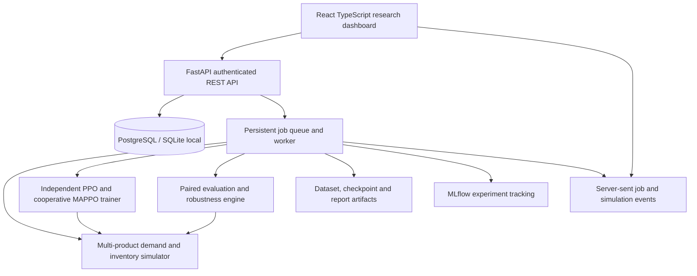

# Collaborative Multi-Agent Reinforcement Learning Framework for Dynamic Pricing in E-Commerce

Status: Phase 1 architecture proposal; implementation awaits user approval as requested in the supplied master prompt.

Product name: PriceMesh Research Platform

## 1. Objective and scope

Build a reproducible research platform and web application for training multiple cooperating product/category pricing agents. Agents optimize an explicitly defined portfolio profit objective subject to stock, price bounds, and price movement constraints. The default environment is an artificial single-retailer marketplace. It is not a connection to a real store and results are not evidence of real-world profitability.

Adapt the supplied fraud-platform specification to this research domain. CTGAN, TVAE, fraud classification, and fraud-specific SHAP pages are not core requirements for pricing. Synthetic demand simulation, cooperative reinforcement learning, policy diagnostics, and held-out scenario evaluation replace them. Optional learned demand models can follow once suitable historical data exists.

Research question: Does collaboration between pricing agents improve held-out portfolio profit, inventory utilization, and robustness compared with independent learning and non-learning pricing baselines?

## 2. Architecture



Frontend: React, Vite, TypeScript, Tailwind CSS, React Router, Axios, Recharts, Lucide. Backend: Python, FastAPI, Pydantic, SQLAlchemy, Alembic, Uvicorn. Research: NumPy, Pandas, SciPy, PyTorch, Gymnasium-compatible environment with a PettingZoo-style parallel agent interface. PyTorch supports explicit MAPPO implementation and auditable training. PostgreSQL is the deployment database; SQLite is a small local fallback. MLflow tracks runs and artifacts. Local execution uses a persistent database job queue and a separate worker process; Redis/Celery is an optional scale-up path, not required for the first deployment.

The API enqueues work and returns a job ID. The worker claims jobs atomically, persists checkpoints and progress, and emits measured completed steps. Polling provides a fallback for SSE. Jobs have queued/running/completed/failed/cancelled states, heartbeat, cancellation checkpoints, and restart recovery. SQLite uses one worker; PostgreSQL supports concurrent workers with row locking. MLflow failure is reported without discarding experiment results stored in the application database.

## 3. Project structure

```text
frontend/
  src/
    components/ layouts/ pages/ routes/ services/ hooks/ context/ types/
backend/
  app/
    api/ core/ database/ models/ schemas/ services/ workers/
  alembic/
pricing/
  environment/ demand/ constraints/ rewards/
  agents/ training/ baselines/ evaluation/ diagnostics/
configs/
scripts/
tests/
  unit/ integration/ frontend/ e2e/
docs/
  SYSTEM_ARCHITECTURE.md DATABASE_SCHEMA.md API_DOCUMENTATION.md
  MODEL_EVALUATION.md INSTALLATION_GUIDE.md TESTING_GUIDE.md
  DEPLOYMENT_GUIDE.md
datasets/ artifacts/ reports/
docker/
README.md PROJECT_REQUIREMENTS.md AGENTS.md
docker-compose.yml .env.example .gitignore
```

Generated data and checkpoints are ignored by Git. Documentation is created with its corresponding implementation phase, so documents never claim unimplemented functionality.

## 4. Database schema

All IDs are UUIDs, dates are UTC, and owned resources carry owner_id. Configuration and result payloads use validated, versioned JSON. Financial reporting uses explicit currency and fixed precision; simulator computations use floating point with documented tolerances.

| Table | Main fields and relations |
| --- | --- |
| users | id, email unique, password_hash, role, created_at |
| user_settings | user_id unique FK, theme, preferences_json |
| catalogs | id, owner_id FK, name, currency, version |
| products | id, catalog_id FK, sku, category, cost, reference_price, min_price, max_price, initial_stock; unique catalog+sku |
| scenarios | id, owner_id FK, catalog_id FK, name, schema_version, demand_config, horizon, constraints, seed |
| datasets | id, owner_id FK, scenario_id FK, artifact_path, checksum, row_count, metadata |
| experiments | id, owner_id FK, scenario_id FK, name, algorithm, config, code_version, dataset_id nullable FK |
| runs | id, experiment_id FK, job_id FK, seed, status, mlflow_run_id, start/end timestamps |
| policies | id, run_id FK, checkpoint_path, checksum, observation/action schema, normalizer_path |
| run_metrics | id, run_id FK, step, metric, value; unique run+step+metric |
| evaluation_suites | id, owner_id FK, name, heldout_config, seeds, version |
| evaluations | id, policy_id FK, suite_id FK, baseline, metrics_json, trajectory_path |
| simulations | id, owner_id FK, scenario_id FK, policy_id nullable FK, seed, status |
| pricing_decisions | id, simulation_id FK, product_id FK, step, observed_state, proposed_price, applied_price, quantity, reward, constraint_events |
| jobs | id, owner_id FK, type, status, completed_units, total_units, heartbeat, error, config, timestamps |
| reports | id, owner_id FK, experiment_id nullable FK, evaluation_id nullable FK, format, artifact_path |
| notifications | id, user_id FK, job_id nullable FK, message, read_at |
| audit_events | id, user_id FK, action, resource_type, resource_id, timestamp |

Index owner/time lists, experiment runs, run/step metrics, job status/heartbeat and simulation/step decisions. Enforce ownership in every resource query. Reject cross-owner references. Prevent deleting resources referenced by completed experiments unless an explicit archive/deletion workflow handles artifacts. Large trajectories remain in artifact files, with paginated decision samples available through the API.

## 5. All 32 frontend pages

Every route has its own purpose, controls, API integration, loading/error/empty states, and contextual links. Shared tables and charts are reusable components, not duplicate placeholder pages.

| # | Route | Working functionality |
| --- | --- | --- |
| 1 | /dashboard | Actual run counts, latest profit and evaluation summaries, recent activity |
| 2 | /overview | Research workflow, assumptions and module readiness |
| 3 | /catalog | Product CRUD, costs, prices and stock configuration |
| 4 | /datasets/generate | Generate seeded synthetic demand and transaction trajectories |
| 5 | /datasets | Search, preview, paginate and export generated datasets |
| 6 | /datasets/quality | Missing values, validity, price bounds and distribution checks |
| 7 | /demand | Configure elasticity, substitution, seasonality and demand diagnostics |
| 8 | /scenarios | Create, clone, validate and run marketplace scenarios |
| 9 | /agents | Agent-product/category assignments and observation/action specification |
| 10 | /collaboration | Shared reward, centralized critic and agent contribution diagnostics |
| 11 | /constraints | Price floors/ceilings, maximum price movement and inventory rules |
| 12 | /rewards | Profit and optional explicit penalty terms with formula preview |
| 13 | /training | Launch IPPO/MAPPO jobs, measured progress, cancellation and curves |
| 14 | /baselines | Run fixed, rule-based and myopic demand-informed pricing |
| 15 | /policies | Checkpoint registry, metadata and compatibility validation |
| 16 | /compare | Paired policy/baseline metrics on matching held-out scenarios |
| 17 | /simulation | Start, pause, resume, step and stop a seeded simulated market |
| 18 | /decisions | Search pricing decisions and inspect state, action and reward |
| 19 | /inventory | Stock, sell-through, replenishment and lost-sales trajectories |
| 20 | /analytics | Revenue, profit, conversion proxy, price and demand trends |
| 21 | /robustness | Launch predeclared multi-scenario evaluation suite |
| 22 | /drift | Compare train/test demand and elasticity conditions |
| 23 | /sensitivity | Sweep elasticity, noise and reward penalty coefficients |
| 24 | /stress | Demand collapse/spikes, stock shortages and competitor-price shocks |
| 25 | /performance | Confidence intervals, constraint violations and baseline-relative results |
| 26 | /explanations | Action probabilities and controlled feature perturbation diagnostics |
| 27 | /experiments | Configure experiments and immutable configuration snapshots |
| 28 | /history | Run/job history, errors, seeds and reproducibility metadata |
| 29 | /reports | Generate/download result-backed CSV, JSON and PDF reports |
| 30 | /users | Profile; admin user and role management with audited changes |
| 31 | /settings | Theme, defaults, artifact retention and integration settings |
| 32 | /system | Health, worker/DB status and link to interactive API documentation |

Desktop fixed/collapsible sidebar, mobile drawer, breadcrumb, theme switch, notifications, connection status and global resource search. Navigation uses React Router and deployment fallback supports direct URLs. Search returns only authorized resources. Empty dashboards show no fabricated results. Simulation pages visibly identify artificial data.

## 6. API specification

Prefix /api/v1. JSON schemas and examples are generated into FastAPI OpenAPI. Bearer JWT access tokens, refresh token rotation and revocation, hashed passwords, role checks, login rate limits and exact allowed CORS origins. Refresh tokens use HttpOnly cookies with CSRF protection appropriate to the deployment. No default administrative password.

| Method/path | Purpose |
| --- | --- |
| POST /auth/register, /auth/login, /auth/refresh, /auth/logout | Session lifecycle |
| GET /auth/me; GET/PATCH /settings | Current user and settings |
| GET/POST /catalogs; GET/PATCH /catalogs/{id} | Catalog management |
| GET/POST /catalogs/{id}/products; PATCH/DELETE /products/{id} | Validated product management |
| GET/POST /scenarios; GET/PATCH /scenarios/{id} | Scenario management and immutable versions used by runs |
| POST /datasets/generate; GET /datasets | Dataset job and listing |
| GET /datasets/{id}, /datasets/{id}/preview, /datasets/{id}/quality | Dataset inspection |
| GET /datasets/{id}/download?format=csv\|json | Authorized export |
| GET/POST /experiments; GET /experiments/{id} | Experiment definitions |
| POST /experiments/{id}/runs; GET /experiments/{id}/runs | Queue training and list runs |
| GET /runs/{id}, /runs/{id}/metrics | Run state and learning curves |
| GET /policies; GET /policies/{id} | Policy registry |
| POST /evaluations; GET /evaluations/{id} | Policy and baseline evaluation jobs |
| POST /evaluations/compare | Compare matching suite, scenario and seed results |
| POST /robustness; GET /robustness/{id} | Robustness suite execution/results |
| POST /simulations; GET /simulations/{id} | Create and inspect simulation |
| POST /simulations/{id}/control | Validated pause/resume/step/stop commands |
| GET /simulations/{id}/decisions | Filtered paginated decisions |
| GET /simulations/{id}/events | Reconnectable SSE simulation events |
| POST /policies/{id}/diagnostics | Bounded feature perturbation diagnostics |
| GET /jobs/{id}, /jobs/{id}/events; POST /jobs/{id}/cancel | Job progress and cancellation |
| GET /dashboard, /search, /notifications | Actual aggregates and authorized search |
| PATCH /notifications/{id} | Mark notification read |
| POST /reports; GET /reports/{id}/download | Background report generation/export |
| GET /admin/users; PATCH /admin/users/{id} | Admin-only user management |
| GET /health/live, /health/ready; GET /system/status | Liveness, readiness, authorized diagnostics |

List endpoints use bounded pagination and stable ordering. POST job requests support idempotency keys. Validate price/cost consistency, finite numbers, dimensions, seed ranges and resource budgets. Missing/unauthorized resource IDs return consistent errors. Artifact downloads use database IDs and server-resolved paths. Uploaded CSVs have size/row limits, schema validation and no arbitrary executable content. Never load user-supplied pickle/checkpoint code.

## 7. Synthetic e-commerce methodology

Each episode models products, finite inventory and discrete time. Demand depends on own price elasticity, substitution/complement effects, seasonality, promotions, exogenous competitor prices and seeded stochastic shocks. Use bounded log-intensity and Poisson or negative-binomial counts; support an outside option and shared demand budget when required to avoid unbounded market demand. Fulfilled units are capped by inventory and sales cannot be negative. Document that cross-elasticity coefficients are assumptions, not estimates from real shoppers.

Generate product, time, offered price, cost, available stock, latent requested demand, fulfilled units, revenue, profit, seasonality and scenario identifiers. Latent demand is only for simulator diagnostics; actors do not observe future shocks or unfulfilled latent demand unless explicitly enabled as a separate experimental condition. Historical sales are censored at stock-outs. Separate training, validation and final test scenario/seed manifests before training. Store all configuration versions, checksums and random seeds. Fit any normalizers on training data only.

## 8. Collaborative reinforcement learning

One actor per product initially, with category-level grouping configurable. Observations include current inventory, own price/cost, past fulfilled demand, time features and the permitted shared summary. Actions are a discrete grid of price adjustments, simplifying bounded exploration and reproducibility. A deterministic safety layer clips actions to valid price and movement constraints and logs every intervention. Sold-out agents stay inactive with a no-op action while episode shapes remain stable.

Baseline algorithms: fixed reference price, transparent inventory-aware rules, and a demand-informed myopic optimizer labelled as having privileged simulator knowledge when it uses true demand parameters. Learning comparison: independent PPO (local critic, local profit reward) and cooperative MAPPO (centralized critic during training, decentralized actors at execution, shared portfolio reward). Add a shared-reward independent-critic ablation to separate reward sharing from critic centralization.

Default team reward is total realized margin: sum_i ((price_i - cost_i) * fulfilled_units_i), scaled by a fixed training-only scale. Optional holding, stock-out and price-change penalties are configurable and reported separately. Revenue, profit and shaped reward are distinct metrics. Shared rewards support coordination across substitutable products; they do not guarantee stable or optimal learning.

Implement PPO clipped objective, GAE, terminal/truncation handling, action probabilities, critic loss, entropy regularization, gradient clipping, observation normalization state, deterministic evaluation mode and reproducible checkpoint loading. Keep actor observations free of privileged critic-only state. Policies never use future information. Record environment interactions and wall time for fair training-budget comparisons. Same initial stock and horizon are used across methods.

## 9. Evaluation and robustness methodology

Predeclare train/validation/test partitions of scenario parameters and random streams. Tune on validation only and select checkpoints by validation portfolio profit with constraint checks. Evaluate final checkpoints on the same held-out episode seeds as baselines. Use separate environment random generators and exogenous shock tapes so action-dependent random-number consumption cannot invalidate paired comparisons.

Report at least 5 independent training seeds in the research preset; a single-seed quick demo is labelled insufficient for statistical conclusions. Aggregate episodes within a trained policy seed before across-training-seed confidence intervals to avoid treating correlated episodes as independent training replications. Provide paired differences with bootstrap intervals, raw seed results and full configurations. Match environment-step budgets, model capacity where feasible and tuning budgets. Do not assert improvement without actual measured results.

Metrics: net profit, gross revenue, fulfilled units, sell-through, stock-out rate, terminal inventory, average price, price-change magnitude, constraint violations, safety interventions, training time and sample efficiency. Demand conversion is only reported if the simulator explicitly models visits/opportunities. Regret is reported only relative to a clearly defined available comparator; do not claim a true optimal oracle without solving the relevant control problem.

Experiments: A fixed/rule baseline; B independent PPO; C cooperative MAPPO; D shared-reward local-critic ablation; E MAPPO without shared observation summary; F stress tests for all frozen policies. Stress dimensions include elasticity shift, seasonality change, increased demand noise, competitor-price shock, supply shortage, observation loss and abrupt demand collapse/spike. Define relative degradation as (in-distribution profit - shifted profit) / max(abs(in-distribution profit), epsilon), show absolute differences too, and flag near-zero denominators. Avoid an opaque aggregate robustness score.

Explanations use action probabilities and controlled perturbation plots with valid-state checks. They describe local policy sensitivity, not causal consumer behavior. SHAP may be an optional later policy-surrogate diagnostic, with fidelity measured and its limitations disclosed.

## 10. Implementation phases and dependencies

1. Architecture review and approval (current phase).
2. Frontend design system, navigation, responsive layout and route verification.
3. API, database migrations, authentication, ownership and durable worker foundation.
4. Catalog, scenario configuration, simulator, reproducible data generation and exports.
5. Baselines and complete evaluation harness; verify accounting and seed pairing.
6. Independent PPO, then MAPPO, checkpointing and policy registry.
7. Robustness, ablations, paired comparisons and diagnostics.
8. Connect all frontend pages to their corresponding working services.
9. Simulation streaming, notifications and reconnect/cancellation behavior.
10. Unit/integration/frontend/end-to-end tests and security checks.
11. Result-backed reports, full documentation and Docker deployment verification.

Backend contracts guide frontend development. Simulator/accounting tests must pass before learning results are interpreted. Evaluation must exist before making algorithm performance claims. A route shell is not considered a completed module.

## 11. Hardware and execution presets

Planning estimates, to be measured on this machine during implementation:

- Quick local demo: modern 4-core CPU, 8 GB RAM minimum, 16 GB preferred, approximately 5 GB free disk excluding optional tooling; 3 products, 30-step episodes and a small training budget. CPU training is supported; no claim that short demo training converges.
- Research runs: 8+ CPU cores, 16–32 GB RAM and 10+ GB free disk; 5–20 products, longer horizons, 5+ training seeds and larger interaction budgets. An optional compatible GPU can accelerate neural network work; simulator throughput may remain CPU-bound.
- Docker Desktop and PostgreSQL/MLflow increase memory requirements. SQLite and a single worker offer the lightweight development path. Dependency downloads require internet access.
- Actual runtime depends on hardware, batch size, agent count and episode budget; benchmark before promising completion times.

## 12. Testing and acceptance

Unit tests cover simulator determinism, inventory conservation, profit accounting, action bounds, observation isolation, reward computation, truncation handling and checkpoint reload equivalence. Integration tests cover ownership, migrations, jobs, failure recovery, SSE reconnection, cancellation and exported artifacts. Learning tests verify finite losses and parameter updates; benchmark results establish effectiveness rather than a flaky test requiring reward improvement. Frontend tests cover forms, error handling and routing. Playwright verifies register/login → scenario → dataset → training → evaluation → report download.

Compose contains frontend reverse proxy, API, worker, PostgreSQL and MLflow with persistent volumes and health checks. Frontend proxy routes /api and supports SPA fallback/SSE. Secrets are supplied through environment variables; .env is ignored. Deployment verification includes actual startup, readiness, persistence after restart and the end-to-end workflow. No cloud publishing or connection to a real store is part of the default scope.

Completion requires a working integrated workflow, all 32 meaningful routes, actual persisted metrics, tested algorithms, downloadable artifacts, documented limitations and a verified local startup. Unexecuted tests or unavailable dependencies will be explicitly reported.

## 13. Open assumptions and technical risks

Default scope is a single retailer coordinating its own products, not autonomous coordination between competing sellers. Competitor prices are exogenous synthetic inputs. Use a single currency per catalog. No personalized/customer-sensitive pricing, payment processing or live store changes. Product-level agents are the first supported granularity. These assumptions are adjustable at architecture review.

Risks include unrealistic demand elasticity, reward hacking, unstable multi-agent optimization, correlated evaluation samples, simulator overfitting, unobserved lost demand and local resource constraints. Mitigate with invariant tests, explicit assumptions, policy/baseline comparisons, frozen test suites, ablations and honest uncertainty. Imported real datasets require a separate schema, quality assessment and provenance review before fitting demand models. Research novelty and publication suitability require a literature review; this blueprint makes no novelty claim.
