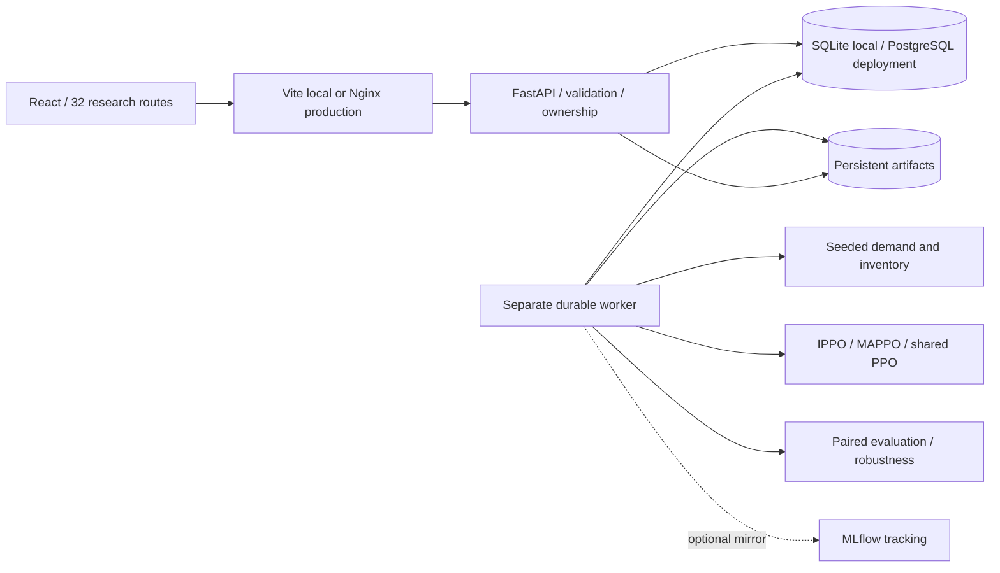

# System architecture

API requests validate schemas and owner-scoped references. Jobs snapshot configurations, return HTTP 202 and remain queued if no worker is online. The separate worker claims a queued job using a conditional database update, executes the real operation and publishes measured progress. Checkpoints contain NPZ tensors and JSON metadata, not executable pickle objects.

Failed workers are detected from stale heartbeats after ten minutes; work becomes failed and requires explicit retry. Cancellation is cooperative between episodes or simulation steps. Restart does not invent completion or silently rerun an experiment. Artifacts may remain after cancelled jobs; retain them for investigation and apply an operator retention policy.

The frontend authenticates with in-memory short-lived JWTs and rotated HttpOnly refresh cookies. Same-origin production routing is preferred. Authentication, sessions, resources, audit events and jobs survive process restart through database persistence. Artifact storage must be shared between API and worker. Back up database and artifact volume consistently.
